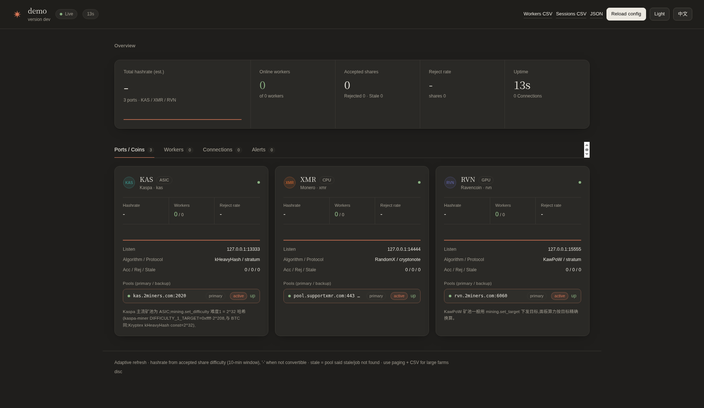
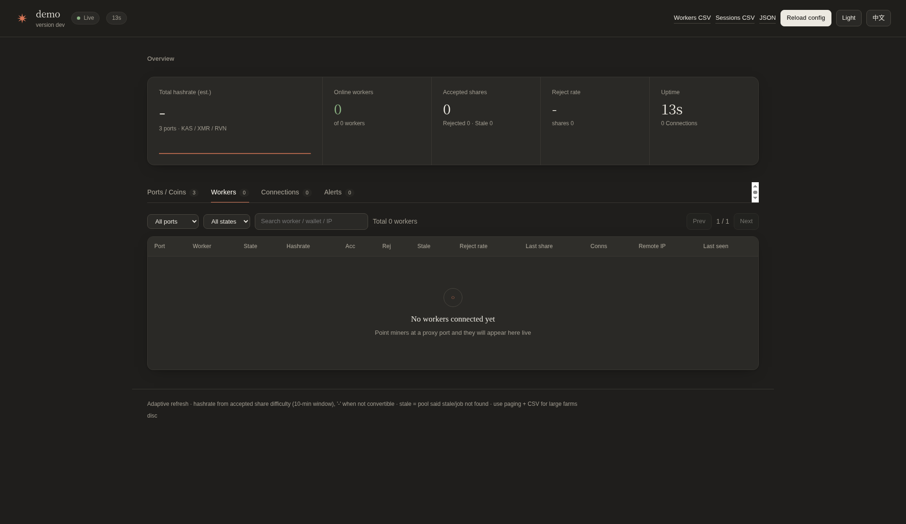
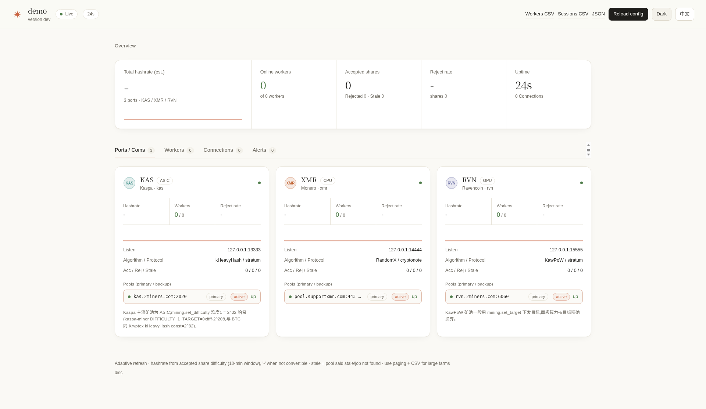
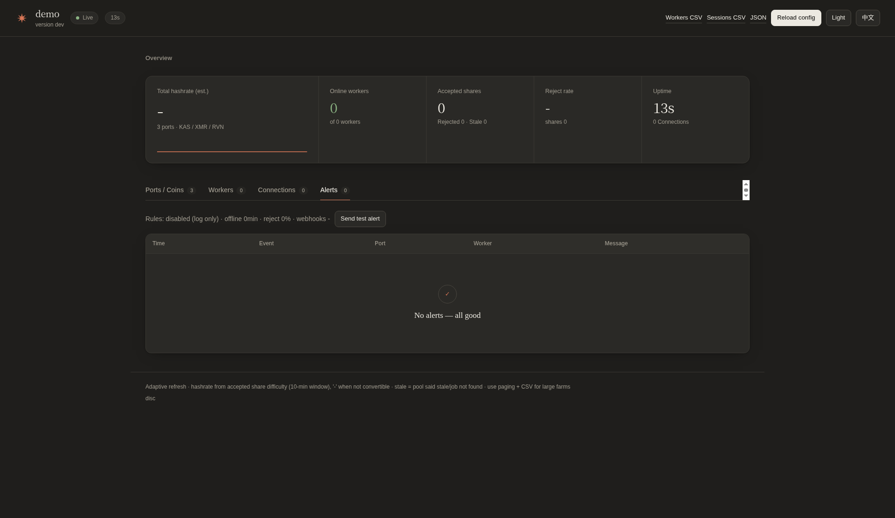

# pearl-proxy

<p align="center">
  
</p>

<p align="center">
  <b>多币种矿池中转 · 就近接入 · 实时面板</b><br/>
  让矿机连得更稳、延迟更低，一台服务器统一管多币种矿场。
</p>

<p align="center">
  <a href="https://github.com/Forlives/pearl-proxy-release/releases/latest"></a>
  
  
</p>

**简体中文** · [English](README_EN.md)

> 本仓库只提供**预编译程序**与使用说明，不含源码。最新版 **[v0.6.5](https://github.com/Forlives/pearl-proxy-release/releases/tag/v0.6.5)**。

---

## 为什么用它

矿机直连远方矿池时，延迟高、掉线重连频繁。把 **pearl-proxy** 部署在靠近矿机的服务器上：

- 矿机只连本地/机房中转
- 中转与上游矿池保持长连接，自动重连与主备切换
- 一个面板看清所有币种、端口、矿机状态

适合矿场、工作室与多币种混挖场景。

---

## 界面预览

| 深色总览 | 矿机列表 | 端口总览 |
|:---:|:---:|:---:|
|  |  |  |

| 浅色主题 | 告警 | 健康检查 |
|:---:|:---:|:---:|
|  |  |  |

---

## 核心能力

| | |
|---|---|
| 🚀 **就近加速** | 长连接复用，降低握手与抖动 |
| 🔄 **自动容灾** | 主备矿池健康检查与故障切换 |
| 🪙 **多币种多端口** | BTC / LTC / KAS / RVN / ETC / XMR / ZEC / PEARL 等主流档案 |
| 📊 **实时面板** | 算力趋势、份额、在线状态；中英双语、深浅色 |
| 🛡️ **接入防护** | 每 IP 并发与速率限制、黑白名单 |
| 🔒 **可选 TLS** | 上游与接入侧均可加密 |
| 🤖 **脚本友好** | `-init` / `-check` / `-coins` / `/healthz` |

---

## 一分钟上手

### Linux（推荐）

```bash
curl -fsSL https://github.com/Forlives/pearl-proxy-release/releases/latest/download/install.sh | sudo bash
```

安装后按提示生成配置，或手动：

```bash
./pearl-proxy -init -coin KAS -pool kas.2miners.com:2020 -config config.json
./pearl-proxy -config config.json
```

面板默认：`http://127.0.0.1:8080`  
矿机指向：`stratum+tcp://服务器IP:端口`

### Windows

1. 打开 [Releases](https://github.com/Forlives/pearl-proxy-release/releases/latest)
2. 下载 `pearl-proxy-windows-amd64.exe`、`config.example.json`、`start-windows.bat`
3. 双击 `start-windows.bat`

---

## 支持的主流币种

运行 `./pearl-proxy -coins` 查看完整列表。内置档案覆盖：

**ASIC** — BTC · BCH · FB · LTC · DOGE · KAS · ZEC  
**GPU** — RVN · ETC · ETHW · PEARL  
**CPU** — XMR  

其它币种可在配置里用自定义 `coins` 档案接入（需兼容 Stratum / ethproxy / cryptonote 之一）。

---

## 多端口示例

```jsonc
{
  "ports": [
    { "name": "kas", "listen": "0.0.0.0:3333", "coin": "KAS",
      "pool": { "url": "kas.2miners.com:2020" } },
    { "name": "xmr", "listen": "0.0.0.0:4444", "coin": "XMR",
      "pool": { "url": "pool.supportxmr.com:443", "tls": true } },
    { "name": "rvn", "listen": "0.0.0.0:5555", "coin": "RVN",
      "pool": { "url": "rvn.2miners.com:6060" },
      "backup_pools": [ { "url": "备用矿池:端口" } ] }
  ],
  "dashboard": {
    "listen": "127.0.0.1:8080",
    "user": "admin",
    "password": "改成你的强密码"
  }
}
```

完整模板见发布包内的 `config.example.json` / `config.multi.example.json`。

---

## 运维小贴士

- 远程看面板：用 SSH 隧道 `ssh -L 8080:127.0.0.1:8080 user@服务器`
- 健康探针：`GET /healthz`（免登录）
- 改端口 / 币种 / 监听地址后需要重启；其它多数配置支持热重载
- 大矿场请用面板分页与 CSV 导出

---

## 下载

所有平台成品均在 **[Releases](https://github.com/Forlives/pearl-proxy-release/releases/latest)**：

| 平台 | 文件 |
|------|------|
| Linux amd64 / arm64 | `pearl-proxy-linux-amd64` · `pearl-proxy-linux-arm64` |
| Windows amd64 | `pearl-proxy-windows-amd64.exe` |
| macOS Intel / Apple Silicon | `pearl-proxy-darwin-amd64` · `pearl-proxy-darwin-arm64` |

---

## 许可与反馈

Issues / Discussions 欢迎提交。商用部署请自行评估上游矿池条款与当地合规要求。

<p align="center"><sub>pearl-proxy · built for miners</sub></p>
